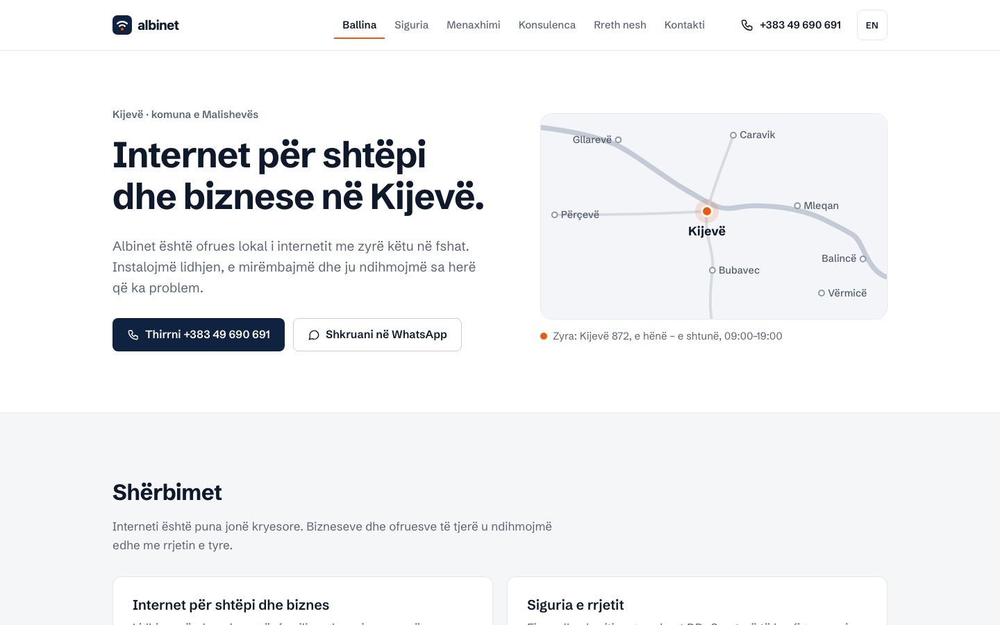
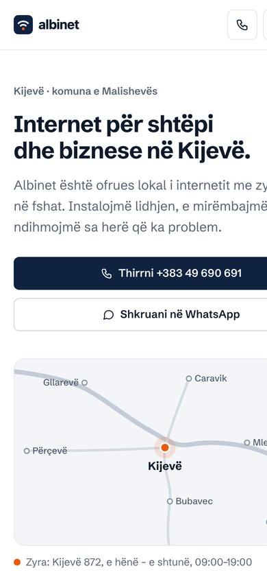

# Albinet website

Website for **Albinet (Albi@Net)**, a local internet provider in Kijevë, Kosovo.
Bilingual (Albanian / English), mobile-first, and plain static files: HTML, CSS, vanilla JavaScript and one PHP file for the contact form. No build step, no framework.

**Live demo:** https://erlisgashi67-commits.github.io/albinet-website/
(The demo runs on GitHub Pages, which can't run PHP, so the contact form shows an error there. On the real cPanel hosting it sends an e-mail.)





**Features**
- 6 pages: Home, ISP Security, ISP Management, ISP Consulting, About, Contact
- Albanian by default, English with one click (the choice is remembered)
- Contact form with spam protection (honeypot + rate limit), plus phone, WhatsApp and Viber buttons
- SEO: unique titles and descriptions, Open Graph tags, LocalBusiness structured data, sitemap.xml, robots.txt
- No libraries; accessible markup (skip link, keyboard menu, labelled form, screen-reader text)

---

The rest of this file is the deployment and editing guide for the albi-net.com hosting.

```
/index.html        Home
/security.html     ISP Security
/management.html   ISP Management
/consulting.html   ISP Consulting
/about.html        About
/contact.html      Contact (form, map, phone/WhatsApp/Viber/email)
/404.html          "Page not found"
/contact.php       Sends the contact form by e-mail
/assets/css/style.css
/assets/js/i18n.js   English translations
/assets/js/main.js   Language toggle, mobile menu, contact form
/assets/img/         Logo, favicon, share image
/sitemap.xml  /robots.txt  /.htaccess
```

## 1. Upload with cPanel File Manager

1. Zip the **contents** of this folder (select all files and folders inside it, including the hidden `.htaccess`, then zip). Don't zip the outer folder itself, or everything ends up one level too deep.
   - macOS: in Finder press `Cmd + Shift + .` to show hidden files before selecting.
2. Log in to cPanel and open **File Manager**.
3. Open `public_html` (the folder for albi-net.com).
4. If an old site is there, back it up first (select its files → **Compress**), then delete the old files.
5. Click **Upload**, choose the zip, wait for 100%, go back.
6. Right-click the zip → **Extract** → extract into `/public_html`.
7. Check that `public_html/index.html` exists (not `public_html/albinet/index.html`). Delete the zip.
8. Open https://albi-net.com on your phone and computer.

**HTTPS:** in cPanel → **SSL/TLS Status**, make sure AutoSSL has issued a certificate for albi-net.com and www.albi-net.com. Then open `.htaccess` (enable "Show Hidden Files" in File Manager → Settings) and un-comment the four "Force HTTPS" lines.

## 2. Contact form (contact.php)

Open `contact.php` and edit the settings at the top:

```php
const RECIPIENT_EMAIL = 'isp.albinet@gmail.com';   // where messages arrive
const FROM_EMAIL      = 'noreply@albi-net.com';    // sender, must be on albi-net.com
```

For the e-mails to reach Gmail reliably:

1. cPanel → **Email Accounts** → create `noreply@albi-net.com` (any strong password; you never need to log in).
2. cPanel → **Email Deliverability** → if albi-net.com shows problems, click **Repair** so SPF and DKIM are valid.
3. Test: open https://albi-net.com/contact.html, send a message, check the inbox **and the Spam folder** of `isp.albinet@gmail.com`. If it lands in Spam once, mark it "Not spam".

What the form already does:
- Required fields: name, phone, message. Email is optional; if given, "Reply" in Gmail answers the customer directly.
- Spam protection: a hidden "honeypot" field (bots fill it, people never see it) and a limit of one message per 30 seconds per visitor.
- Shows a success or error message in the visitor's language, without reloading the page. Without JavaScript it still works (normal POST, then back to the contact page with the message).

If messages never arrive: cPanel → **Track Delivery** shows whether the server sent them; cPanel → **Errors** / `error_log` in `public_html` shows PHP problems. The site needs PHP 7.4 or newer (cPanel → **MultiPHP Manager**).

## 3. Editing text and translations

The site is bilingual: **Albanian is the default**, English is switched with the **EN / SQ** button. The choice is remembered on that device. You can also link straight to English with `?lang=en`, e.g. `https://albi-net.com/?lang=en`.

- **Albanian text** is written directly in the HTML files. Every translatable element has a `data-i18n="some.key"` attribute, e.g.
  `<h1 data-i18n="home.h1">Internet i shpejtë, i sigurt dhe pranë jush.</h1>`
- **English text** for the same key is in `assets/js/i18n.js`:
  `"home.h1": "Fast, secure internet, right on your doorstep.",`
- To change a sentence, change it in both places (the HTML for Albanian, `i18n.js` for English).
- Attributes (page description, menu labels for screen readers, map title) use `data-i18n-attr="content:meta.home.desc"`: the Albanian value is the attribute in the HTML, the English value is the key in `i18n.js`.
- To add new text: give the element a new unique key, e.g. `data-i18n="home.newLine"`, and add `"home.newLine": "English text",` to `i18n.js`. Keep translated elements to plain text (no links or icons inside them; wrap just the words in a `<span data-i18n="...">`).
- The header, footer and menu are repeated in each HTML file. If you change them, change them in all 7 HTML files (use your editor's "find in files").
- After changing CSS or JS, increase the version in the HTML (`style.css?v=1` → `?v=2`, same for the two scripts) so visitors don't get the old cached file.

Page titles and descriptions (for Google) are in each page's `<head>`: `<title>` and `<meta name="description">`. Facebook/WhatsApp link previews use the `og:` tags right below them.

## 4. Placeholders to fill in (search for `TODO`)

| What | Where |
|---|---|
| Logo | Replace `assets/img/logo.svg` (dark text, header) and `logo-light.svg` (white text, footer). Also `favicon.svg`, `favicon-32.png`, `apple-touch-icon.png`, `og-image.png` (1200 × 630, used when the link is shared). |
| Brand colours | `assets/css/style.css`, the `:root` block at the top (`--navy` and `--accent`). |
| Internet packages / prices | `index.html`, service 01 in "Çfarë bëjmë". Add prices there or as a new section. |
| Founding year | The site says "since 2013" / "more than ten years" (from the KPM licence of 6 June 2013). Confirm with the owner. |
| IPKO partner line | `about.html`, from IPKO's sales-points page (Jan 2024). Remove it if it's no longer current. |
| Team | `about.html` has a commented-out team section ready to fill in (names, roles, photos about 400 × 400 `.webp`). |
| Coverage area | `index.html`, "Ku punojmë": list the villages you cover. |

Already filled in from public sources (check they're still right): opening hours Mon–Sat 09:00–19:00 (IPKO sales-points page), business number 80561776 and ARKEP registration (ARKEP notification register, 2023), Malishevë municipality (KPM decision), Facebook page facebook.com/AlbiNetKijeve.

## 5. SEO and performance notes

- Each page has its own title, description, canonical URL and Open Graph tags. `index.html` and `contact.html` include LocalBusiness structured data (address Kijevë 872, 24060 Kijevë, Kosovo).
- After going live, add the site in **Google Search Console** and submit `https://albi-net.com/sitemap.xml`. Create or claim the **Google Business Profile** with the same name, address and phone.
- No libraries are loaded. Third-party requests: the "Schibsted Grotesk" font from Google Fonts (one stylesheet, in each page's `<head>`) and the Google Maps embed on the contact page (lazy-loaded). Without the font the site falls back to the system font. `.htaccess` enables compression and browser caching.
- Test with Chrome DevTools → **Lighthouse** (Mobile) or https://pagespeed.web.dev after uploading.
